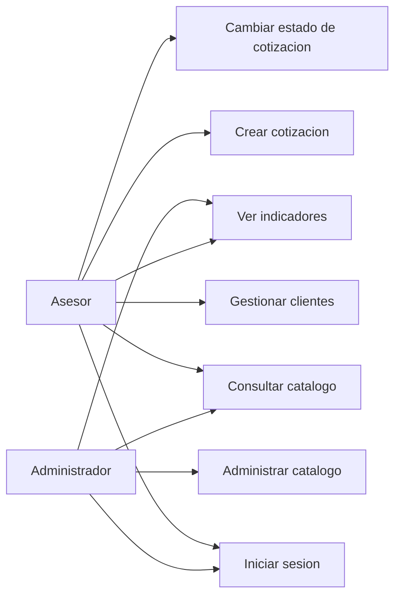
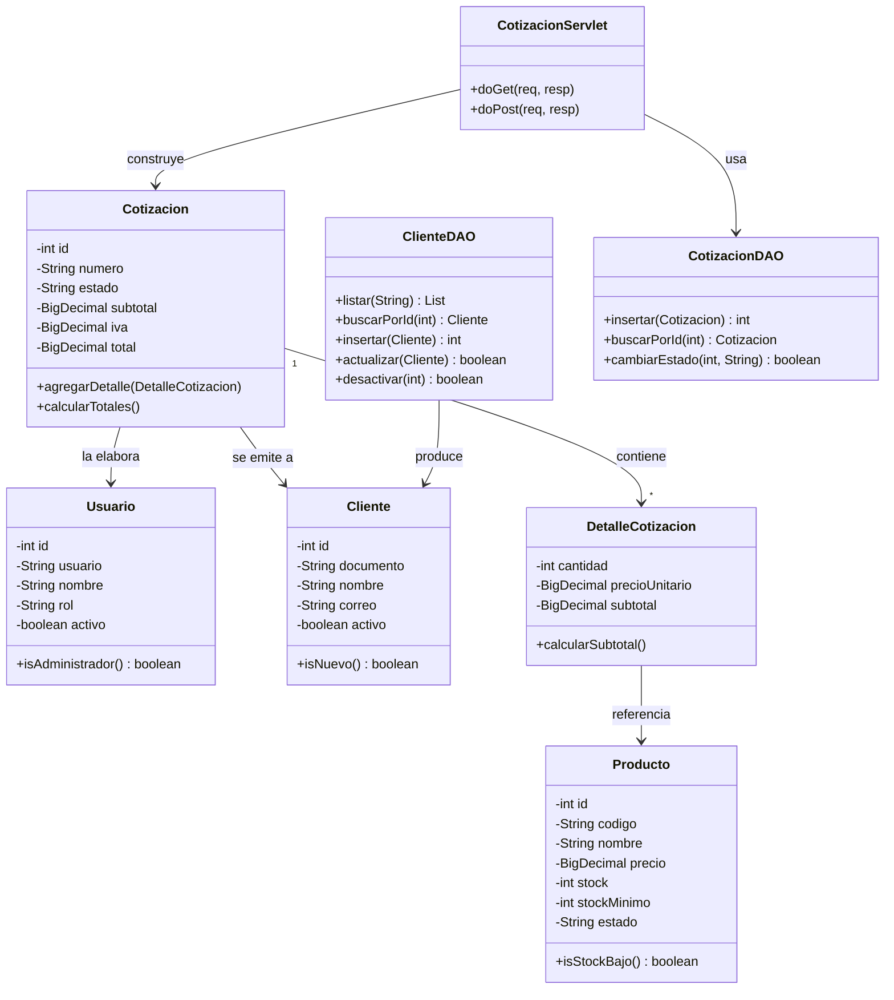
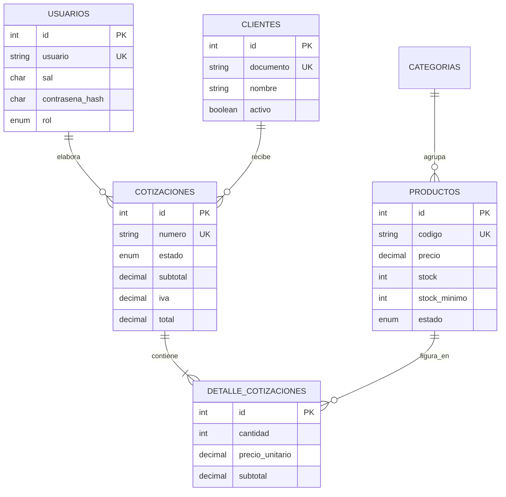
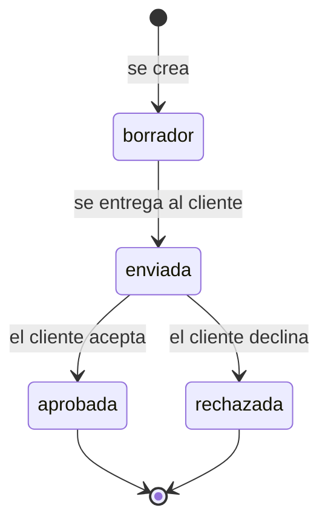

# Informe técnico del módulo

**Evidencia GA7-220501096-AA2-EV02 — Módulos de software codificados y probados**
Proyecto: Sistema de Showroom y Ventas · Módulo Comercial
Aprendiz: José Cortés

> Requisito del enunciado: *"Para la codificación del módulo debe tener en cuenta
> los artefactos del ciclo del software realizados con anterioridad: diagrama de
> clases, diagramas de casos de uso, historias de usuario, diseños, prototipos,
> informe técnico de plan de trabajo para construcción de software con
> tecnologías seleccionadas."*

---

## 1. Alcance del módulo

El proyecto formativo completo administra la operación de un showroom de
muebles. De ese sistema, **esta evidencia codifica el Módulo Comercial**, que es
el que sostiene la venta: sin clientes registrados y sin catálogo no hay
cotización, y sin cotización no hay pedido.

| Dentro de este módulo | Fuera de este módulo |
|---|---|
| Autenticación y roles | Facturación electrónica |
| Clientes | Despachos y logística |
| Catálogo y existencias | Contabilidad |
| Cotizaciones con IVA y estados | Portal público para el cliente final |

---

## 2. Historias de usuario

| # | Como... | quiero... | para... |
|---|---|---|---|
| HU-01 | asesor | ingresar con usuario y contraseña | que nadie ajeno vea la información comercial |
| HU-02 | asesor | registrar un cliente nuevo cuando llega al showroom | poder cotizarle de inmediato |
| HU-03 | asesor | buscar un cliente por nombre o documento | no recorrer toda la lista cuando vuelve |
| HU-04 | asesor | consultar el catálogo con precios y existencias | responder sin ir a la bodega |
| HU-05 | asesor | armar una cotización con varios productos | entregarle al cliente un documento con el total real |
| HU-06 | asesor | que el sistema calcule el IVA y el total | no equivocarme en la aritmética frente al cliente |
| HU-07 | asesor | marcar la cotización como enviada, aprobada o rechazada | saber en qué va cada negocio |
| HU-08 | administrador | crear y editar productos | mantener el catálogo al día |
| HU-09 | administrador | ver qué productos están por debajo del mínimo | reponer antes de quedarme sin existencias |
| HU-10 | administrador | que el asesor no pueda cambiar precios | evitar que se altere el catálogo por error |

---

## 3. Casos de uso

### CU-04 — Crear cotización (el caso central)

| | |
|---|---|
| **Actor** | Asesor o administrador |
| **Precondición** | Sesión activa; existe al menos un cliente activo y un producto con existencias |
| **Postcondición** | Cotización guardada en estado `borrador`, con número consecutivo y totales calculados |

**Flujo principal**

1. El actor abre *Nueva cotización*.
2. El sistema muestra los clientes activos y el catálogo disponible.
3. El actor selecciona el cliente y escribe las cantidades.
4. El actor envía el formulario.
5. El sistema descarta las líneas con cantidad cero.
6. Para cada línea, **el sistema toma el precio del catálogo**, no del formulario.
7. El sistema calcula subtotal, IVA del 19 % y total.
8. El sistema asigna el número consecutivo y guarda la cabecera y el detalle **en una sola transacción**.
9. El sistema muestra el detalle del documento.

**Flujos alternativos**

| Condición | Respuesta del sistema |
|---|---|
| Ninguna línea con cantidad mayor que cero | Devuelve el formulario con el mensaje correspondiente |
| La cantidad supera las existencias | Informa cuántas unidades hay disponibles |
| El producto está descontinuado | Rechaza esa línea indicando el producto |
| No se seleccionó cliente | Marca el campo como obligatorio |
| Falla la escritura del detalle | `rollback`: no queda cotización a medias |

---

## 4. Diagrama de clases

**Por qué `Cotizacion` calcula sus propios totales:** la regla de negocio vive
en el objeto del dominio y no en el servlet. Si mañana el módulo se consume
desde una aplicación de escritorio o desde una API, la aritmética sigue siendo
la misma porque no está atada a HTTP.

---

## 5. Modelo de datos

Tres decisiones del modelo que conviene sustentar:

1. **`precio_unitario` se guarda en el detalle**, aunque el producto ya tenga
   precio. Una cotización es un documento histórico: si el precio del catálogo
   cambia, el documento debe seguir mostrando lo que se le ofreció al cliente.
2. **Los totales se guardan en la cabecera** por la misma razón: no se
   recalculan al consultar.
3. **`ON DELETE CASCADE` en el detalle**: nunca deben quedar líneas apuntando a
   una cotización inexistente.

---

## 6. Máquina de estados de la cotización

Las transiciones válidas se declaran en `CotizacionServlet.esTransicionValida()`.
Sin esa comprobación, una petición cualquiera podría devolver a `borrador` una
cotización ya aprobada, y el estado de los negocios dejaría de ser confiable.
Está probado: las verificaciones CP-25 y CP-27 intentan transiciones inválidas y
el sistema las rechaza.

---

## 7. Diseño de la interfaz

Seis pantallas, todas con el mismo encabezado y pie incluidos con
`jsp:include`:

| Pantalla | Archivo | Formulario |
|---|---|---|
| Ingreso | `login.jsp` | POST con usuario y contraseña |
| Tablero | `vistas/tablero.jsp` | — |
| Clientes | `vistas/clientes/lista.jsp` | GET de búsqueda + POST de desactivación |
| Cliente (alta y edición) | `vistas/clientes/formulario.jsp` | POST con seis campos |
| Catálogo | `vistas/productos/lista.jsp` | GET con dos filtros |
| Producto | `vistas/productos/formulario.jsp` | POST con ocho campos |
| Nueva cotización | `vistas/cotizaciones/formulario.jsp` | POST con líneas múltiples |
| Detalle de cotización | `vistas/cotizaciones/detalle.jsp` | POST de cambio de estado |

La hoja de estilos es propia (`recursos/estilos.css`), sin frameworks externos:
así el módulo se ve igual sin conexión a internet.

---

## 8. Plan de trabajo y tecnologías seleccionadas

### 8.1. Por qué Servlets y JSP

| Alternativa | Por qué no se eligió |
|---|---|
| Spring Boot | Resuelve mucho de forma automática, y precisamente por eso oculta el ciclo petición-respuesta que esta actividad busca que se entienda. |
| JSF | Abstrae el formulario HTML en componentes; aquí el objetivo es escribir el formulario y atenderlo con un servlet. |
| PHP | Es el lenguaje de otra evidencia del mismo proyecto; esta pide Java con Servlets. |
| **Servlets + JSP** | **Elegido.** Es el estándar de Java EE para web, lo que pide el enunciado y lo que corre en el Tomcat que ya trae XAMPP. |

### 8.2. Estándares de codificación aplicados

| Estándar | Cómo se aplica |
|---|---|
| Convención de nombres de Java | Clases en `PascalCase`, métodos y variables en `camelCase`, constantes en `MAYUSCULAS_CON_GUION` |
| Paquetes en minúscula y jerárquicos | `co.edu.sena.showroom.<capa>` |
| Una responsabilidad por clase | Modelo, DAO, servlet, filtro y utilidad están separados |
| Nombres en español | Coherente con el dominio y con el resto del proyecto formativo |
| Comentarios breves y al grano | Una línea por clase, y comentarios puntuales solo donde el código no se explica solo |
| Indentación de 4 espacios | En Java, JSP, XML y SQL |
| Sin SQL fuera de los DAO | Ningún servlet ni JSP contiene una consulta |
| Sin lógica de negocio en las vistas | Las vistas consultan propiedades ya calculadas |
| Recursos liberados siempre | `try-with-resources` en todas las conexiones y sentencias |

### 8.3. Orden de construcción

| Etapa | Entregable |
|---|---|
| 1 | Modelo de datos y script SQL |
| 2 | Clases del modelo (POJOs) |
| 3 | Conexión y DAO con consultas preparadas |
| 4 | Validador y utilidades de seguridad |
| 5 | Servlets con sus `doGet` y `doPost` |
| 6 | Filtros de codificación y autenticación |
| 7 | Vistas JSP y hoja de estilos |
| 8 | `web.xml` con rutas, filtros y páginas de error |
| 9 | Pruebas sobre Tomcat y MySQL |
| 10 | Documentación y publicación en el repositorio |

El orden no es casual: cada etapa solo depende de las anteriores, de modo que
siempre se puede probar lo construido sin tener que simular lo que falta.
